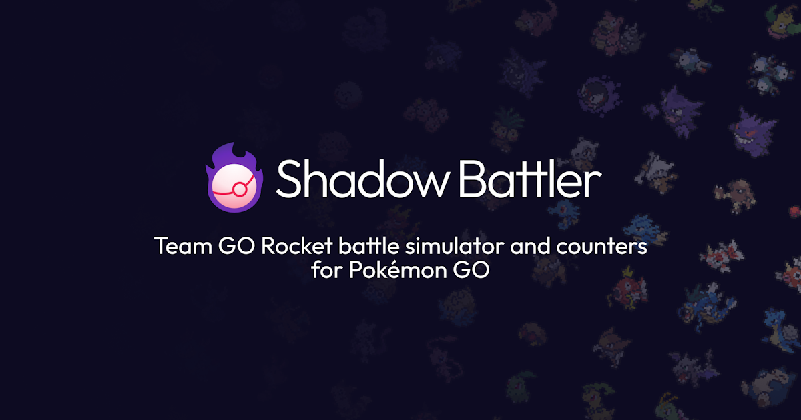

#  Shadow Battler

[Shadow Battler](https://shadowbattler.com/) is a tool for Pokemon GO that simulates Team GO Rocket battles to quantitatively determine which Pokemon are fastest and most consistent for defeating each Team GO Rocket opponent.

## Overview

`backend` is a Spring Boot app used for parsing JSON game data, battle simulations, and the database. `frontend` is a Next.js app which also includes public API endpoints.

The base battle simulation algorithm is TeamBattleSolver, which solves a battle between a player Pokemon and an enemy team of 3 Pokemon, all with predetermined moves. This search algorithm explores every possible player decision (as the enemy AI is entirely predictable) to find the fastest possible win, if one exists.

Opponents randomly select a team from a lineup of possible Pokemon, where each Pokemon also has random moves. To account for this randomness, OpponentBattleSolver solves a battle between a player Pokemon and an opponent's lineup by running TeamBattleSolver for each team permutation and averaging out the results.

To sort and compare battle results, the backend saves them to a database during a reconciliation process. Reconciliation finds differences between the local game data (stored as JSON in the backend's resources directory) and the game data stored in the database. Then, all battle simulations dependent on modified data are ran and saved to the database, and the database updates its version of the game data to match the local game data.

## Hosting locally

### Setup

0. Have Java 21, Node.js 20.9 (or later), npm, and PostgreSQL installed
1. Start PostgreSQL and create an empty database for the app
2. Copy `backend\.env.example` as `backend\.env`, and `frontend\.env.local.example` as `frontend\.env.local`
3. Edit `backend\.env` so `DB_URL`, `DB_USERNAME`, and `DB_PASSWORD` match your PostgreSQL database and user. For example, if you created a database named `shadowbattler`, set `DB_URL` to `jdbc:postgresql://localhost:5432/shadowbattler`
4. In `backend\.env`, Leave `USE_TEST_JSON=true` to use the included test game data. For development, I'd highly recommend using test data as the production dataset can take up to a day to process. Additionally, `RECONCILE_ENTITIES=true` enables the database reconciliation endpoint (see the reconciliation section)
5. Run `npm install` in `frontend`. You should not need to modify `frontend\.env.local` unless the backend is running on a port other than 8080

### Running

1. Open a terminal in `backend` and run:

```powershell
.\mvnw.cmd spring-boot:run
```

2. Open a second terminal in `frontend` and run:

```powershell
npm run dev
```

3. Open [http://localhost:3000](http://localhost:3000)

### Reconciliation

If you want to populate or refresh the persisted battle results, start reconciliation with a POST request to `api/reconciliation/start`:

```powershell
curl -X POST http://localhost:8080/api/reconciliation/start
```

You can check on reconciliation progress with a GET request to `api/reconciliation/status`:

```powershell
curl -X GET http://localhost:8080/api/reconciliation/status
```

## Contributing

If you're interested in contributing or have any questions, please feel free to reach out! Shadow Battler has a [Discord server](https://discord.gg/RdNV2BjZUV) with a dedicated development channel that I am active in, and I will try and get back to you whenever I'm free.


